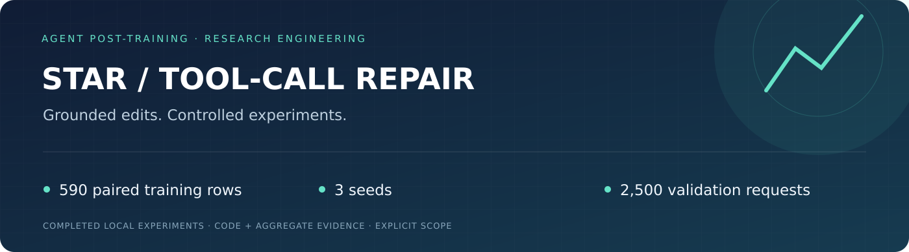
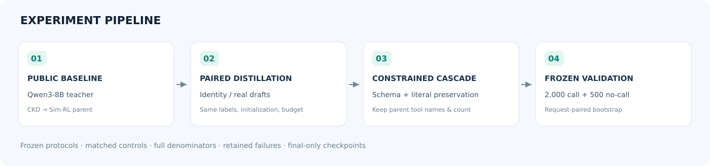
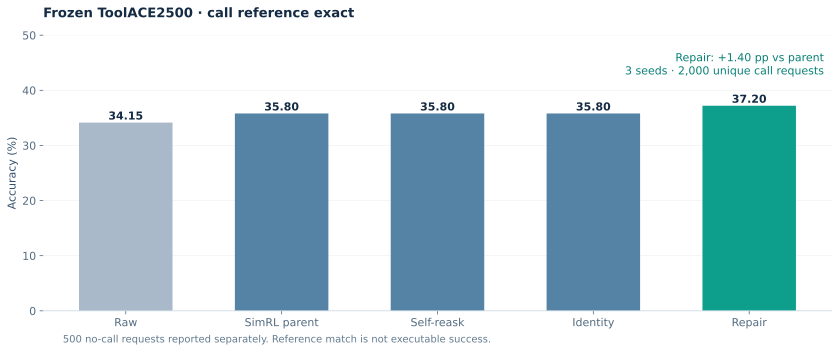

# Grounded tool-call repair for a small language model

[中文](README.md) · [Design](docs/methodology.md) · [Results](docs/results.md) · [Run guide](docs/reproducibility.md)

A scoped research engineering project built on STAR and OpenRLHF: a public-data CKD→Sim-RL parent, matched real-draft repair distillation, and a schema/input-preserving inference cascade.



Paired identity and repair adapters use the same 590 training examples, gold targets, initialization, sample order, 64 steps, batch16 and LoRA rank16. Seeds42/43/44 are all retained. Gold is used for training and post-hoc scoring, never by the inference acceptance gate.



On a frozen prospective cohort of 2000 call and500 no-call requests, mean call reference-exact improves **35.80%→37.20%**. The simultaneous98.333% request-paired interval against parent/identity is **+0.55 to+2.283 pp**. Repair seed scores are37.40/36.95/37.25%.

Limitations matter: no-call remains63.80%, below Raw67.80%; macro remains0.475pp below Raw. A posthoc static-default control reaches36.55% and is not statistically beaten. Prefill is2.113× parent and deployment queries1.7896×. Reference exact is not executable tool success, and this is not a full reproduction of STAR's original teacher/data/BFCL scores.

```bash
pip install -r requirements-cpu.txt
python examples/demo.py
make check
python scripts/report.py
```

GPU scripts require separately obtained checkpoints and frozen data; exact historical parent weights are not distributed. See [reproducibility](docs/reproducibility.md), [references](docs/references.md), and [Apache-2.0](LICENSE).
