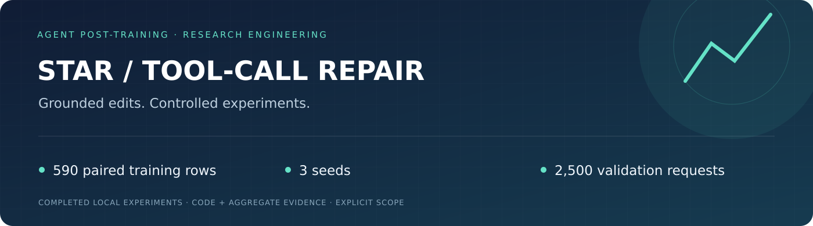
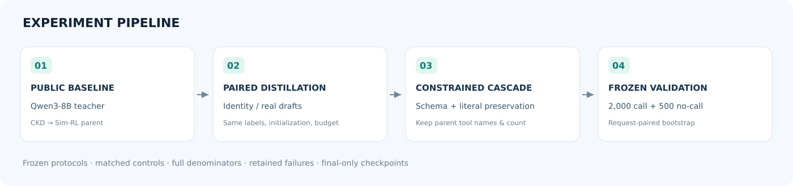
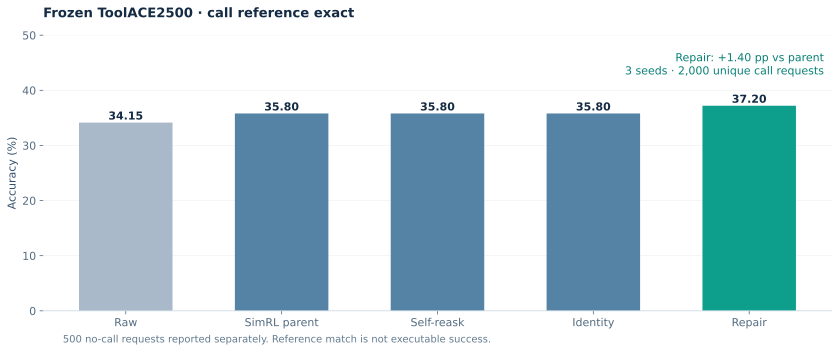
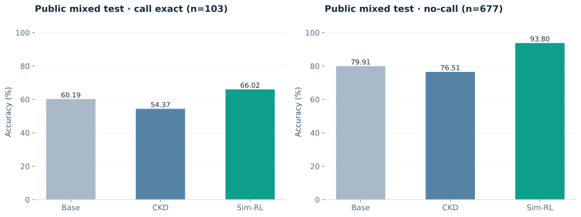

<div align="center">



**面向小模型的工具调用参数修复：从 STAR 训练基线到三随机种子的独立验证**

[](https://github.com/carlyer/star-toolcall-repair/actions/workflows/validate.yml)


[English](README.en.md) · [实验设计](docs/methodology.md) · [完整结果](docs/results.md) · [复现指南](docs/reproducibility.md) · [简历表述](docs/resume.md)

</div>

## 项目概览

小模型经常选对工具，却在参数值、可选字段和用户原文保留上出错。本项目先完成公开数据与通用教师下的 **CKD → Sim-RL** 基线，再研究一个受约束的修复级联：用真实父模型草稿训练 LoRA，仅在 schema、工具名/数量和输入保留检查通过时接受候选。

**已经完成真实训练、三随机种子对照及冻结方法后的 2,500 条独立验证。** 主要结论是工具调用的参考答案匹配率改善，不能外推为真实工具执行成功率或原论文全部指标复现。

| 研究问题 | 本地实现与证据 |
|---|---|
| 如何避免把额外推理预算误当方法收益？ | 父模型重问、identity-draft 与 repair 使用相同候选预算 |
| 如何隔离修复训练的作用？ | 590 条配对训练样本，保持目标、初始化、采样顺序及 64 步预算一致 |
| 如何验证结果？ | seeds 42/43/44；按唯一请求配对 bootstrap，保留全部纠错与退化 |
| 如何衡量代价？ | 报告生成调用数、输入 prefill、no-call 与 macro，而非只展示调用涨点 |

## Pipeline



修复模块的推理输入只有用户请求、工具 schema 和未执行的父模型草稿。**Gold 仅用于训练与事后评分，不进入候选接受逻辑。** 父模型的不调用决策、工具名和调用数量保持不变。

## 核心结果



冻结 2,500 个唯一请求：2,000 条调用、500 条 no-call。三 seed 在每个请求内先平均，再以请求为统计单位。

| 方法 | Call reference exact | No-call | Macro |
|---|---:|---:|---:|
| Raw Qwen3-0.6B | 34.15% | 67.80% | 50.975% |
| Sim-RL 父模型 | 35.80% | 63.80% | 49.80% |
| 同预算父模型重问 | 35.80% | 63.80% | 49.80% |
| 三 seed identity 控制均值 | 35.80% | 63.80% | 49.80% |
| **三 seed repair 均值** | **37.20%** | 63.80% | 50.50% |

- 相对父模型与 identity：**+1.40 个百分点**；预注册多重比较调整后的 98.333% 配对区间为 **[+0.55, +2.283] pp**。
- 三个 seed 分别 **37.40% / 36.95% / 37.25%**，没有按结果选择 seed。
- 事后静态默认参数删除控制为 **36.55%**；repair 相对它的区间跨 0，尚未证明显著优于该简单控制。
- 推理调用数是父模型的 **1.7896×**，输入 prefill 为 **2.113×**；macro 仍比 Raw 低 **0.475 pp**。

证据：[原始汇总](results/toolace2500.json) · [事后审计](results/postflight-audit.json) · [静态控制](results/static-control.json)。修复主要改善参考参数表示与省略模式，未执行真实 API 来证明语义收益。

<details>
<summary><strong>展开：已完成的 CKD → Sim-RL 公开基线</strong></summary>



Qwen3-8B 教师 / Qwen3-0.6B 学生；公开 XLAM 子集与 Hammer，train/val/test = 6,229/778/780。完成 48 个 CKD rollout 周期和 72 个 Sim-RL 接受更新周期。

| 模型 | 调用 exact（103 条） | No-call（677 条） |
|---|---:|---:|
| Base | 60.19% | 79.91% |
| CKD | 54.37% | 76.51% |
| Sim-RL | 66.02% | 93.80% |

该实验使用通用教师与公开数据替代，不能称为原 STAR Teacher-8B / 完整数据 / BFCL 结果复现。[汇总证据](results/public-mixed.json)

</details>

## 快速体验：无需 GPU

```bash
python -m pip install -r requirements-cpu.txt
python examples/demo.py
make check
python scripts/report.py
```

演示使用人工构造的示例，展示错误修改用户明确邮箱时的回退行为；它不是实验测试样本。生成图表：`pip install -r requirements-viz.txt && make figures`。

## 训练与评测入口

```bash
# 需要自行准备父模型 checkpoint、训练任务和逐任务父模型预测
python scripts/build_training_pairs.py --tasks data/train.jsonl \
  --predictions data/parent-train.jsonl --output data/pairs

CUDA_VISIBLE_DEVICES=0 python scripts/train_real_draft_repair.py \
  --base models/simrl-parent --data data/pairs \
  --output results/runs/seed42 --seed 42

python scripts/evaluate_frozen_repair_v2.py --phase dev \
  --base models/simrl-parent --data data/dev.jsonl \
  --control results/runs/seed42/identity/final-adapter \
  --repair results/runs/seed42/repair/final-adapter \
  --output results/runs/dev42
```

以上是新实验入口，不保证重建历史分数。历史父模型权重与完整冻结 cohort 未随代码发布；通用预训练模型不能直接替代历史 Sim-RL 父模型。GPU 环境、上游安装与输入格式见[复现指南](docs/reproducibility.md)。

## 仓库结构

```text
src/                 冻结 schema / grounding gate、修复提示与评分适配
scripts/             配对数据、LoRA 训练、级联评测、证据报告与画图
results/             公开基线、640/2500 请求验证及审计汇总
configs/             历史训练 manifest 与公开基线配置
tests/               用户原文保护、no-call、工具名及 schema 约束检查
docs/                方法、结果、复现、项目讲述与可视化资产
```

## 来源与归属

基于 [STAR](https://github.com/Qwen-Applications/STAR) 与 [OpenRLHF](https://github.com/OpenRLHF/OpenRLHF) 构建。论文方法归原作者；本项目贡献是本地训练适配、配对修复实验、约束级联与证据审计，不宣称修复思想的新颖性。[固定版本与引用](docs/references.md) · [Apache-2.0](LICENSE) · [NOTICE](NOTICE)
