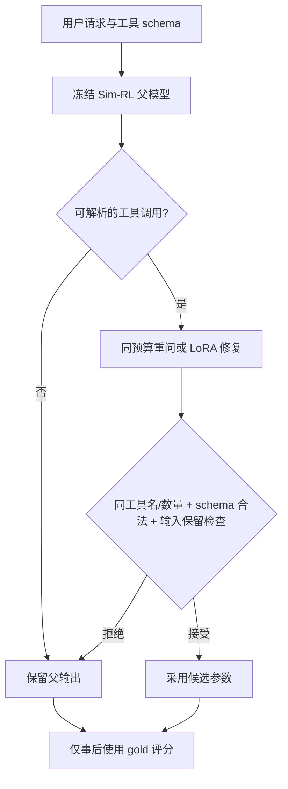

# 背景、方法与实验设计

## 问题定义

工具调用需要同时决定是否调用、选择工具、生成满足 schema 且忠实于用户要求的参数。只训练通用调用策略不一定解决细粒度参数错误。另一次模型重问也可能提高分数，因此需要预算匹配的控制组。

本地研究只考察在父模型已产生可解析调用时的参数修复。它保留原始工具选择与数量，不能处理父模型漏调用、错工具和所有格式错误。

## 两阶段基线

- 学生 Qwen3-0.6B，通用 Qwen3-8B 教师；不是 STAR 专用 Teacher-8B。
- 公开正向 XLAM 1,024 条与 Hammer 6,763 条，保留 train/val/test 的 prompt 隔离。
- CKD：FKL、L1 系数 10、学习率 3e-6；48 个 rollout 周期。
- Sim-RL：group-normalized advantage、学习率 3e-7；3 episodes、72 个接受周期。
- 有效 batch128，每 prompt8 个候选；两张 GPU；每阶段一个 final checkpoint。

## 配对修复训练

对原训练正向任务采集父模型 greedy 草稿。仅选工具名/调用数量一致且 gold 能通过冻结 schema 与输入保留约束的样本，得到 590 行：490 条父模型已正确，100 条参数错误可修。它是受 gate 覆盖限制的训练选择，不是所有错误分布的无偏样本。

| 因素 | Identity 控制 | Repair 方法 |
|---|---|---|
| 任务 ID / gold | 相同 | 相同 |
| 输入草稿 | 正确 gold 草稿 | 真实父模型草稿 |
| 初始化 / batch 顺序 | 同一 seed 配对 | 同一 seed 配对 |
| 训练预算 | 64 steps、batch16、micro4 | 相同 |
| 优化 | AdamW、lr5e-5、LoRA rank16/alpha32 | 相同 |
| Loss | 每样本 assistant target token 均值，再对 batch 平均 | 相同 |
| Seeds | 42 / 43 / 44 | 42 / 43 / 44 |

Identity 是正确草稿分布下的配对蒸馏控制，不是所有常规 SFT 基线的最强代表。

## 推理级联

Gate 使用 schema 和请求文本，拒绝改动明确邮箱/数字、无来源可选参数添加等；结构保护处理部分日期、时长与 city/state 情况。该规则不是通用语义等价或执行正确性证明。

## 验证协议

1. 640 请求首次独立验证后，保持方法、权重、超参数及 gate 不变。
2. 在新的 2,500 请求上做前瞻确认：2,000 调用、500 no-call，唯一归一化请求。
3. 同一请求内先平均三 seed，再进行请求级配对 bootstrap，避免把 seed×请求视为独立样本。
4. 三个主要对照预注册同时区间；不挑 seed，不按测试结果改变 gate。
5. 对所有更改和退化做审计；默认参数省略的参考收益与真实执行收益分开。

请求/文本去重不证明语义去重，也不排除基础模型预训练污染。全部已评测 cohort 现在都是已看参考集。
